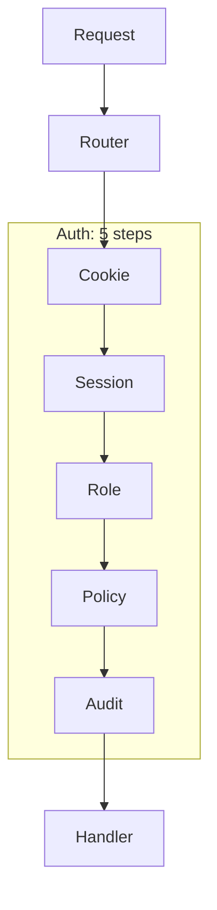
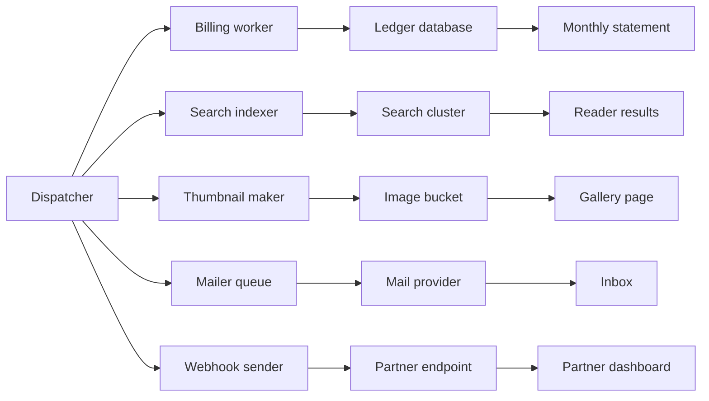
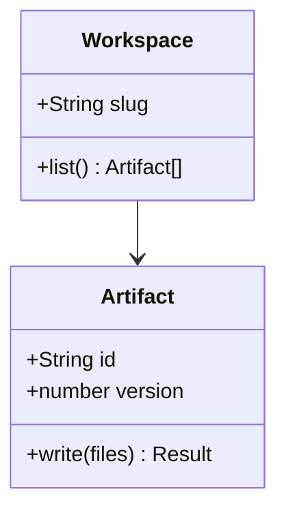

# Stepped diagrams

How a write reaches viewers, a part at a time.

<Diagram
  title="A write, step by step"
  code={`flowchart TD
  agent[Agent] -->|write| compile{Compile}
  compile -- errors --> agent
  compile -- ok --> store[(Storage)]
  subgraph frame[Reader's frame]
    kit[Kit runtime] --> page[Page]
  end
  store --> kit
  page --> check[Render check]:::changed`}
  steps={[
    { focus: "agent compile", title: "The agent writes", text: "The agent sends files; the Worker compiles them and returns errors with line numbers.", state: { "store.version": "12", "kit.version": "12" } },
    { focus: "compile store", title: "It is stored", text: "A clean compile is saved as a new version.", state: { "store.version": "13" } },
    { focus: "frame", title: "Readers see it", text: "The kit runtime in each reader's frame draws the page.", state: { "kit.version": "13" } },
    { focus: "page check", text: "The render check loads the page like a reader would and reports what broke.", state: { "check.errors": "none" } },
  ]}
/>

## Collapsed group

## Dense, so it zooms

## Class members in monospace

