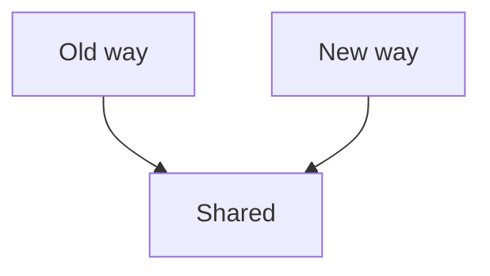

# Keys across

A paragraph before the stats.

<Stats>
  <Stat label="Signups" value="1,284" delta="+18%" />
  <Stat label="Errors" value="7" delta="-5" invert />
  <Stat label="p95" value="420 ms" />
</Stats>

<Grid cols={2}>
  <Card><CardHeader><CardTitle>Card A</CardTitle></CardHeader><CardContent>
A first line.

A second line.
</CardContent></Card>
  <Card><CardHeader><CardTitle>Card B</CardTitle></CardHeader><CardContent>
B first line.

B second line.
</CardContent></Card>
</Grid>

A paragraph after the cards.

<Tabs defaultValue="one">
  <TabsList><TabsTrigger value="one">One</TabsTrigger><TabsTrigger value="two">Two</TabsTrigger><TabsTrigger value="three">Three</TabsTrigger></TabsList>
  <TabsContent value="one">
Tab one text.
</TabsContent>
  <TabsContent value="two">
Tab two text.
</TabsContent>
  <TabsContent value="three">
Tab three text.
</TabsContent>
</Tabs>

<Diagram code={`flowchart TD
  A[Write] --> B[Check] --> C[Read]`} steps={[{focus: "A", text: "Write it."}, {focus: "B", text: "Check it."}, {focus: "C", text: "Read it."}]} />

| Name | Alpha | Beta | Gamma | Delta | Epsilon | Zeta | Eta | Theta | Iota | Kappa | Lambda |
|---|---|---|---|---|---|---|---|---|---|---|---|
| A long row label | 1000000 | 2000000 | 3000000 | 4000000 | 5000000 | 6000000 | 7000000 | 8000000 | 9000000 | 10000000 | 11000000 |

The end.

## Findings

<Findings />

After the findings.

## Shortlist

<Shortlist />

After the shortlist.
