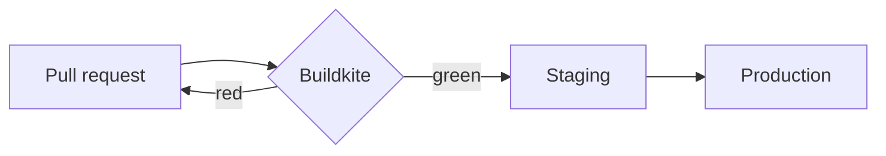

# Artifact kit reference

An artifact has one entry: `index.mdx` / `index.md` (a readable report) or `app.tsx` (a full-height app, `export default function App()`). Other `*.tsx` files import by relative path; `data/*.json` files load with `useData("x.json")` or a component's `data="x.json"`. Allowed imports: `react`, `@a/ui`, `@a/hooks`, `lucide-react`, `recharts`, relative files. MDX gets every `@a/ui` component and styled markdown with no imports. There is no network: no fetch, no external images or fonts (use `data:` URLs).
- `useAsset(path)` → URL of a file uploaded with artifact_asset (e.g. `"assets/logo.png"`); MDX images (``) resolve automatically.

Every markdown page also gets, with nothing to add: a collapsed **Contents** list under the title once it has four or more `##` sections; live, shared checkboxes for task lists (`- [ ] Buy filters`), ticked by people on the page; a **Linked from** footer listing artifacts here that link to it; and section links that work from anywhere (`/a/<id>#<heading-slug>` or `#<element-id>`). A heading's slug is its text lowercased, with runs of other characters turned into single hyphens (`## Bread & butter` → `#bread-butter`); a repeated heading gets `-2`, `-3`. Link between artifacts with their URL (`/a/<id>`); there are no folders, so a hub page that links to the rest is how to group them.

Give each page one purpose. A page that runs past a dozen or so screens on a phone is better split into several artifacts linked from a short hub page (or from each other), so readers find their part and comments stay on topic.

Style with Tailwind classes and theme tokens (the theme is dark only): `bg-background bg-card bg-muted bg-accent bg-primary text-foreground text-muted-foreground text-primary text-primary-foreground border-border text-positive text-caution text-negative bg-chart-1`…`6`, `text-others` (other people's light, for something someone else did), `font-display` (Fraunces, for headings only), `rounded-lg`, `font-mono`. There are no gradient fills. Avoid raw colors like `bg-white` or `text-gray-500`. Readers are often on phones (about 390 px): no fixed widths over about 360 px unless behind `md:`.

## Components (`@a/ui`)

Layout and content
- `Page({title?, subtitle?, wide?})`: centered readable column. MDX is already wrapped in one.
- `Section({title, description?})`, `Grid({cols: 1-6, gap?})`, `Stack({direction?: "row"|"col", gap?, align?})` (a row wraps its items when full; in a row with an `Avatar`, a text `span` or `p` takes the rest of the row and wraps beside it, which makes a byline)
- `Summary`: the lead answer, set large in a tinted panel. Put it first.
- `Callout({tone?: "info"|"success"|"warning"|"danger", title?})`
- `Stat({label, value, delta?: "+12%"|number, hint?, invert?, trend?: number[]})` inside `Stats` (`trend`, oldest first, draws a small line under the value, coloured like the delta; one panel divided into cells; put the `Stat`s directly inside it, not wrapped; a cell's own background and border are replaced by the panel's)
- `Steps` > `Step({title})`; `Timeline` > `TimelineItem({date?, title?, tone?})`
- `Link({href})`: external, opens a new tab. Markdown links do the same.
- `Record({data?: "x.json", items?: {label, value, url?}[] | {[label]: value}, title?})`: facts as a label/value list (a consultation summary, a spec sheet, booking details): two columns on wide screens, label above value on phones; URL values become links.
- `Log({data?: "log.json", title?, show?: 5})`: dated entries `[{date, title, body?, tone?: "neutral"|"positive"|"caution"|"negative", tags?}]`, newest first as ruled rows, older ones behind "Show N earlier". You append to the data file. Use it for checkpoints and change logs instead of "## 24 October checkpoint" headings; use `Ledger` when people on the page add the rows.
- `Figure({src, alt, caption?, credit?, creditUrl?})`: an image (`"assets/x.png"` or a data URL) with caption and credit; never wider than the column; tapping it enlarges it.

Data
- `Table({data: "x.json"|rows, columns?: "a b c"|string[]|{key,label?,format?,align?}[], sort?: "col"|"-col", search?, limit?, empty?, cards?: "auto"|"always"|"never", cardTitle?: "col"})`: sortable headers. Formats numbers, booleans, URLs and ISO dates automatically; `format` can be `number integer percent currency currency:EUR date url bool text` or a function. Store values plain: numbers as numbers (with `currency:CAD` to show money), booleans as `true`/`false`, dates as ISO strings, links as a URL or `{label, url}` (or a list of them, for several in one cell); a link to another artifact here shows its title. Only US dollars show as a bare `$` (CAD reads CA$). On phones, tables with more than three columns show each row as a card titled by its first column, or by `cardTitle` (`cards="never"` keeps the scrolling table).
- `Chart({type?: "line"|"bar"|"area"|"pie", data, x, y: "a"|"a b"|string[], height?: 280, stacked?, legend?, title?})`
- `Sparkline({data: number[]|"x.json", y?, tone?})`
- `Delta({data?: "x.json", rows?, title?, chart?})` with rows `{label, before, after, unit?: "ms"|"s"|"min"|"%"|"KB"|"MB"|"GB"|"$"|…, better: "up"|"down", note?}`: before/after measurements as Label | Before | After | Change. The change is worked out ("−1.2 s · −38% · better"), percentages change in points, units scale (1500 ms reads 1.5 s), and on phones each row keeps After in view. `chart` adds a before-to-after line per row. Use it instead of a pipe table or prose for numbers that changed.
- `BulletBar({label, value, target?, max?, bands?: number[], unit?, better?: "up"|"down"})`: one value against a target (a bullet graph); `bands` are the upper edges of grey ranges.
- A small static table (a few rows you write by hand) is fine as a Markdown pipe table in MDX or Markdown. Use `Table` with a data file when it's large, people need to sort or search it, or it changes.

Diagrams (Mermaid; the only way to draw anything that isn't a `Chart`)
- In MDX/Markdown, write a ```` ```mermaid ```` fenced block; it becomes a themed, responsive, zoomable SVG card (a diagram too wide for the screen gets + and − buttons, pinch and Ctrl-wheel zoom; the page still scrolls past it). In TSX use `Diagram({code: string, title?})` (or the source as children). Fences are syntax-checked on write.
- Pick the type by what you're showing (first line of the source):
  - Process or decision flow: `flowchart TD` (`LR` for short chains)
  - Who calls whom, in order: `sequenceDiagram`; lifecycle: `stateDiagram-v2`
  - Data model: `erDiagram`; types and code structure: `classDiagram`
  - Systems and services: `architecture-beta`
  - Plans and status: `gantt` (dated schedule), `timeline` (milestones), `kanban` (work by column)
  - Ideas and hierarchy: `mindmap`
  - Quantities Chart can't show: `quadrantChart` (2x2 prioritization), `sankey` (flows between stages)
  - Others work too when they fit better: `journey`, `gitGraph`, `C4Context`, `block`, `packet`, `requirementDiagram`, `radar-beta`, `treemap-beta`, `venn-beta`, `swimlane-beta`, `treeView-beta`, `ishikawa-beta` and more.
- `Chart` vs Mermaid: line, bar, area and pie charts of numbers always use `Chart` with a data file (Mermaid `pie` and `xychart` are rejected). Everything above uses Mermaid.
- Keep labels short (2-4 words) and diagrams under ~25 nodes; split bigger ones by section. Let the theme supply colors: no `style`, `classDef` colors, `%%{init}%%` or `theme:` config. Never hand-draw with SVG, positioned divs or ASCII art.
- To show what a change does to a flow, mark flowchart nodes `:::added`, `:::changed` or `:::removed` (the kit's own classes, no `classDef`): they get a sign and an outline, and readers can switch between Before, Both and After. `Diagram({focus: "A B"})` lights those node ids (a subgraph's id lights all of it) and fades the rest.
- To walk a reader through a flow in order: `Diagram({code, title?, steps: [{focus: "A B", title?, text}]})` draws it once with a step bar ("Step 2 of 5", Previous / All / Next, the step's title and text); each step lights its nodes and the edges between them. Every focus id must exist in the diagram. Use it for 3 to 6 parts worth explaining in order, instead of several near-identical diagrams.
- Pick the type by the shape of the thing: `sequenceDiagram` for request flows (who calls whom, in order), `gantt` for timed plans and critical paths, `kanban` for open / waiting / done, `stateDiagram-v2` for lifecycles, `sankey` for funnels and splits. Readers are on phones: collapse a big flowchart's detail into groups (`subgraph auth[Auth] … end`, then `auth@{ view: collapsed }`), and never fan 10 or more nodes out of one node.
- A few changed lines of code: a ```` ```diff ```` fence, or `Diff({code, file?})` in TSX. Lines start with `+`, `-` or a space, as `git diff` prints them.

Primitives
- `Button({variant?: default|secondary|outline|ghost|destructive|link, size?: sm|default|lg|icon|icon-sm})`
- `Badge({tone?: neutral|primary|positive|caution|negative|outline})`
- `Card`, `CardHeader`, `CardTitle`, `CardDescription`, `CardContent`, `CardFooter`
- `Input`, `Textarea`, `Label`, `Select({options: (string|{value,label})[], value?, defaultValue?, onValueChange?, placeholder?})`. `Input`, `Textarea` and `Select` fill their container's width, in a flex row too (put one in a `w-44` wrapper to size it); a `Label` sits on its own line above its control, so `space-y-1.5` or `flex flex-col gap-1.5` spaces them. Give the control an `id` and the label `htmlFor`.
- `Checkbox` and `Switch({checked?, defaultChecked?, onCheckedChange?, label?})` (without `label`, pass `aria-label`); `Slider({value?, defaultValue?, min?, max?, step?, onValueChange?, "aria-label"?})`
- `Tabs({defaultValue})` > `TabsList` > `TabsTrigger({value})`, then `TabsContent({value})`
- `Accordion` > `AccordionItem({value})` > `AccordionTrigger` + `AccordionContent`
- `Dialog` > `DialogTrigger` (`render={<Button/>}` to restyle) + `DialogContent` > `DialogHeader` > `DialogTitle`, `DialogDescription`, then `DialogFooter`, `DialogClose`
- `Popover` > `PopoverTrigger` + `PopoverContent({side?, align?})`; `Tooltip({content, side?})` wraps one element; it's a hover extra that phones never show, so nothing people need goes only in a tooltip
- `Progress({value, max?, label?})`, `Separator`, `Avatar({email?|name?, src?, size?})` (a person is a small ghost in their own colour with their initials; with `src`, a round photo), `AvatarGroup({emails})` (a row of them), `Kbd`, `Skeleton`, `ScrollArea`

Recipes (one data file, drawn in a fixed order and checked on save; read the topic in `artifact_guide` first)
- `ChangeGuide({data?: "guide.json"})`: a code change explained for someone with no context: verdict and next action (with an on-page decision), before/after with measurements and screenshots, one map walked stop by stop, what was checked (red-first tests included) and what to check once it ships (topic "change").
- `Shortlist({data?: "shortlist.json"})`: a decision between 2 to 10 real options: the pick and why with an AsOf stamp, what matters, ranked rows (verdict, price, one-line summary) that open to pros and cons, the deciding question, facts and evidence, ruled-out options folded at the end, and optionally a `Decision` with the pick recommended (topic "shortlist").
- `Findings({data?: "findings.json"})`: an audit or review (performance, cost, latency, CI, security, a postmortem's "what to fix"): the question and answer, a status roll-up, a generated impact-against-effort chart, findings ranked by impact then effort (each with change, benefit, how to validate and before/after metrics), what isn't worth doing, how it was measured, and a long inventory showing its top rows (topic "findings"). When a fix ships, set its `status` in the data; don't add a Callout.

Sources and freshness
- `Sources({data?: "sources.json", title?: "Sources", open?: true})`: the numbered list a page rests on, from `[{id, title, url?, checked?: "2026-10-25", kind?: "primary"|"official"|"provider"|"report"|"forum"|"owner", note?}]`. Each row shows its link, kind and "Checked 3 days ago". `open={false}` starts a long list closed. Use it instead of hand-built source lists; the save check refuses a malformed file.
- `Cite({id, data?: "sources.json"})`: a superscript `[n]` after the sentence it supports, linking to that source's row; an id the file doesn't have is refused on save.
- `AsOf({checked: "2026-10-25", next?: "2026-11-25", scope?: "prices"})`: an inline stamp, "Checked 3 days ago · prices"; past `next` it says "Due for a recheck". Use it instead of "Checked on <date>" in prose.
- `Claim({status: "verified"|"reported"|"inferred"|"unknown", note?})`, optionally wrapping text: how sure a statement is, with an icon and a word.

Live and shared (they work without extra code; view-only and anonymous viewers see results read-only)
- `Poll({id, options, multiple?, question?})`: shows counts and who voted.
- `Checklist({id, items: string[], allowAdd?})`: shows who checked each item.
- `Comments({id?: "main", title?})`: newest last, with author and time.
- `Notes({id, placeholder?, rows?})`: a shared textarea that saves as you type and shows who last edited it.
- `Approval({id, title?, description?, approvers?: string[]})`: sign-off. Each person approves or requests changes, with an optional note; with `approvers` (emails) it reads "Approved" once all of them approve and lists who it's waiting on. Decisions are at `approve/<id>/<email>` as `{decision: "approve"|"changes", note?, by, at, version}`, where `version` is the one the person was looking at. A decision made on an earlier version than the page shows as needing a new look and doesn't count until they decide again.
- `Form({id, fields, title?, description?, submitLabel?, showResponses?: true})`: collects one response per person, which they can edit. `fields` is `{name, label?, type?: "text"|"textarea"|"number"|"email"|"date"|"select"|"checkbox", options?, required?, placeholder?, hint?}[]`. Field values are text, numbers or true/false. Responses are at `form/<id>/<email>` as `{values, by, at, version}`, and everyone who can open the artifact can read them (`showResponses={false}` only hides the table).
- `Ledger({id, fields, data?, sort?, total?, title?, description?, addLabel?})`: a log people add rows to on the page (payments, check-ins, tastings, stock), for anything that would otherwise end in a Notes box. `fields` are Form fields plus an optional Table `format` (`"currency:CAD"`). Anyone with edit access adds rows; only whoever added a row (or the owner) edits or deletes it. Entries are at `ledger/<id>/<row>` as `{values, by, at, editedBy?, editedAt?}`; read them with artifact_state (agents can't add or change entries, only delete one after folding it into the data file). `data="past.json"` shows rows you keep in a data file alongside, read-only, and `total="amount"` sums a field across both. To fold entries into the data file, write them there and delete the keys.
- `Decision({id, question, options: string[] | {value, label, detail?}[], recommended?, deciders?: string[], description?})`: a question answered on the page that remembers one shared answer, with who chose it and when; changing it asks first. `recommended` marks one option "Recommended"; with `deciders` (literal emails) only they can decide. The answer is at `decide/<id>` as `{choice, note?, by, at, version}`; agents read it but can't set it.
- `SourceRecords({data, title?: "Source records"})`: records kept with a page for reference (what it was imported from, raw evidence), closed until opened so they cost the reader nothing. Each shows its `title`/`name` (linked by `url`) and its other fields; nested objects show as JSON. Use it instead of rendering raw JSON on the page.
- Ids: every stateful component's `id` (`Poll`, `Checklist`, `Comments`, `Notes`, `Approval`, `Form`, `Ledger`, `Decision`) names its keys in shared state, so give each one on a page its own id, 1-64 letters, digits, `-`, `_` or `.`, and keep it once people have answered (a new id starts empty). `Approval`, `Form`, `Ledger` and `Decision` reject any other id; a `/` breaks the others. Only people make decisions and responses, in the page; agents read them with artifact_state.
- Use `Decision` when someone must choose and the answer should stand (the owner, or named `deciders`), `Poll` to gauge opinion across many people where no single answer is final, `Approval` for a go/no-go on the page as it stands (approvals lapse when it changes), and `Form` when you need specific facts back from each person. Share with `edit` access the people who should take part; `view` is read-only.

## Hooks (`@a/hooks`)

- `useShared(key, default)` returns `[value, set]`. Shared live with everyone. `set(v | prev => v)` updates instantly. `null` deletes. The last write per key wins.
- `useSharedMap<T>(prefix)` returns `{entries: [key, T][], get, set, delete}` over keys `prefix/<key>`. Use it for lists.
- `useLocal(key, default)` returns `[value, set]`. Private to this viewer and persists across visits. `localStorage` works too.
- `useViewer()` returns `{email: string|null, role: "owner"|"edit"|"view", canWrite}`.
- `usePresence()` returns the emails viewing now. `useTheme()` returns `"dark"` (the kit is dark only).
- `useData<T>(path)` returns the parsed `data/*.json` contents and throws if the file is missing.

Shared-state rules: store one key per list item (`todo/<id>`), never a whole array under one key, or concurrent edits get lost. Values are JSON, at most 64 KB each. Writes from `view` or anonymous viewers are ignored, so check `canWrite` to disable controls. Forms cannot navigate: handle Enter and clicks yourself, or call `e.preventDefault()` in `onSubmit`.

## Example: `index.mdx` with `data/tools.json`

````mdx
# Picking a CI provider

<Summary>Use **Buildkite**: fastest on our monorepo and cheapest at our scale.</Summary>

<Stats>
  <Stat label="Median build" value="6m 10s" delta="-38%" invert />
  <Stat label="Cost / month" value="$420" />
</Stats>

## Options

<Table data="tools.json" columns="name minutes price selfHosted" sort="minutes" />

<Callout tone="warning">Self-hosted agents need one more runner box.</Callout>

## How it ships



## Decide

<Poll id="ci" options={["Buildkite", "GitHub Actions", "CircleCI"]} />
<Checklist id="next" items={["Trial on the monorepo", "Get a quote"]} allowAdd />
<Comments />
````

## Example: `app.tsx`

```tsx
import { useState } from "react";
import { Button, Card, CardContent, CardHeader, CardTitle, Checkbox, Input } from "@a/ui";
import { useShared, useSharedMap, useViewer } from "@a/hooks";

type Item = { text: string; done: boolean };

export default function App() {
  const { canWrite } = useViewer();
  const [title, setTitle] = useShared("title", "Launch list");
  const items = useSharedMap<Item>("item");
  const [draft, setDraft] = useState("");
  const add = () => { if (draft) items.set(crypto.randomUUID(), { text: draft, done: false }); setDraft(""); };
  return (
    <div className="mx-auto max-w-xl p-6">
      <Card>
        <CardHeader><CardTitle>{title}</CardTitle></CardHeader>
        <CardContent className="flex flex-col gap-3">
          {items.entries.map(([id, it]) => (
            <Checkbox key={id} label={it.text} checked={it.done} disabled={!canWrite}
              onCheckedChange={(done) => items.set(id, { ...it, done })} />
          ))}
          <div className="flex gap-2">
            <Input value={draft} onChange={(e) => setDraft(e.target.value)} disabled={!canWrite}
              onKeyDown={(e) => e.key === "Enter" && add()} />
            <Button onClick={add} disabled={!canWrite || !draft}>Add item</Button>
          </div>
          {!canWrite && <p className="text-[13px] text-muted-foreground">Read-only: ask the owner for edit access.</p>}
          <Button variant="ghost" onClick={() => setTitle("Launch list (final)")}>Rename</Button>
        </CardContent>
      </Card>
    </div>
  );
}
```
